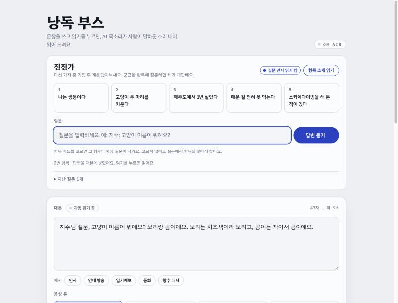
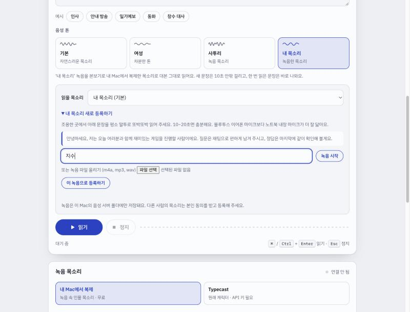
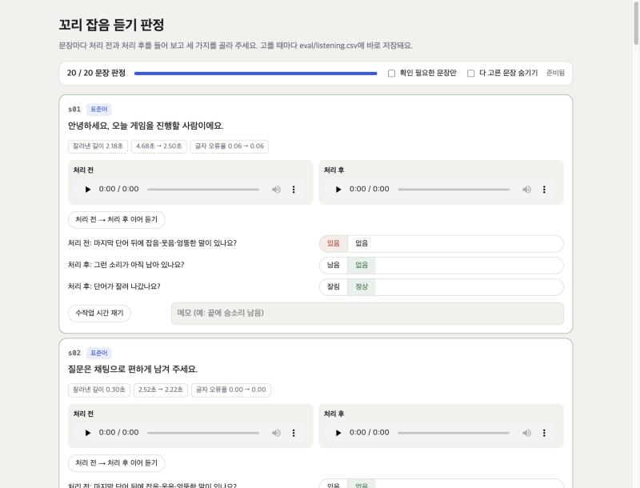

# AI 낭독 음성 꼬리 잡음 자동 제거 PoC

로컬 음성 복제 모델(Chatterbox)이 만든 음성에서, **문장이 끝난 뒤 붙는 잡음·웃음·엉뚱한 말을 사람 손 없이 잘라내는** 파이프라인입니다.
온라인 모임(ZEP)에서 AI가 사투리 목소리로 즉석 답변을 읽어 주는 게임을 진행하다가 만난 문제를 해결하려고 만들었습니다.

```
대본 → Chatterbox(음성 생성) → Demucs(목소리만 분리) → faster-whisper(마지막 단어 위치 찾기) → 자르기 → 깨끗한 음성
```

## 결과 한눈에 보기

20문장(표준어 10, 사투리 10)을 직접 들어 보고 판정했습니다.

| | 처리 전 | 처리 후 |
|---|---|---|
| 마지막 단어 뒤에 꼬리 소리가 있는 문장 | **15 / 20 (75%)** | **0 / 20** |
| 단어가 잘린 문장 | - | **0 / 20** |
| 사람이 편집할 문장 | 15개 | 0개 |
| 추가 처리 시간 | - | 문장당 평균 3.1초 |

자세한 내용과 실패 사례는 [검증 결과](docs/03-evaluation.md)에 있습니다.

## 문서

| 문서 | 내용 |
|---|---|
| [1. 문제 정의서](docs/01-problem.md) | 도메인, 현재의 문제, 개선 가설, 대상 사용자, 성공 기준 |
| [2. 모델 선정 근거](docs/02-model-selection.md) | 단계별 후보 비교와 선택 이유, 설정 |
| [3. 개선 효과 검증](docs/03-evaluation.md) | 처리 전후 비교, 대표 사례, 실패 사례, 평가의 한계 |
| [4. 한계와 다음 단계](docs/04-limits-next.md) | 한계, 추가 시도(메모리 누수 수정, 현장 적용), 도입에 필요한 것 |
| [5. 개발 진행 및 결과](docs/05-development-log.md) | 시작부터 현장 적용, 검증, 개선까지 단계별 기록 |
| [6. 개발 스펙과 아키텍처](docs/06-architecture.md) | 구성도, 파이프라인 설정, 구성 요소별 API, 저장 위치, 설계상 선택 |
| [7. 사용자 매뉴얼](docs/07-user-manual.md) | 설치, 켜고 끄기, 화면별 사용법, 내 목소리 등록, 진진가 진행, 문제 해결 |

## 실행 방법

**환경**: Python 3.11, Apple Silicon Mac에서 시험했습니다. 메모리는 16GB 이상을 권장합니다. 모델 파일은 처음 실행할 때 Hugging Face에서 내려받습니다(수 GB).

```bash
python3.11 -m venv .venv
source .venv/bin/activate
pip install -r requirements.txt
```

**1. 참조 목소리 준비**
본인 목소리를 10~15초 녹음해 `refs/my_voice.wav`로 저장하세요. 조용한 곳에서 내장 마이크로 녹음하면 됩니다. 블루투스 이어폰 마이크는 음질이 낮아 권하지 않습니다. 저장소에는 목소리 녹음을 넣지 않았습니다.

```bash
# Mac에서 음성 메모(m4a)를 wav로 바꾸는 방법
afconvert -f WAVE -d LEI16@24000 -c 1 refs/sample.m4a refs/my_voice.wav
```

**2. 한 문장 만들기**

```bash
python src/clean_tts.py --ref refs/my_voice.wav --text "좋아요, 다음 질문 받을게요!" --out out.wav --keep-stages
# out.raw.wav(처리 전), out.voice.wav(목소리 분리), out.wav(최종)이 만들어집니다.
```

**3. 평가 다시 돌리기**

```bash
python eval/run_eval.py --ref refs/my_voice.wav   # 20문장, 약 5분
python eval/listen_server.py                      # http://127.0.0.1:8770/ 에서 듣고 판정
```

같은 참조 목소리와 시드를 쓰면 같은 음성이 다시 만들어집니다.

## 낭독 부스 웹사이트로 직접 써 보기

실제 행사에 쓴 '낭독 부스' 화면을 내 컴퓨터에서 웹사이트로 띄워, 목소리를 등록하고 그 목소리로 읽어 볼 수 있습니다. 위 설치(`pip install -r requirements.txt`)를 마친 가상환경에서 실행합니다.

**켜기**

```bash
python web/serve.py
```

터미널에 `낭독 부스: http://127.0.0.1:8780/  (끄려면 Ctrl+C)`가 나오면 Chrome이나 Safari에서 그 주소를 엽니다. 포트를 바꾸려면 `PORT=8790 python web/serve.py`처럼 실행합니다.

**끄기**: 서버를 켠 터미널에서 **Ctrl+C**를 누릅니다. 음성 모델은 5분 동안 쓰지 않으면 스스로 메모리를 비우고 종료합니다.

**확인해 볼 기능**

| 순서 | 할 일 | 확인할 것 |
|---|---|---|
| 1 | 음성 톤에서 **기본** 또는 **여성**을 고르고 **읽기** | 브라우저 음성으로 대본을 읽음 |
| 2 | 음성 톤에서 **내 목소리** → **내 목소리 새로 등록하기** | 녹음 상자가 열림 |
| 3 | 이름을 적고 **녹음 시작** → 화면의 문장을 읽고 **녹음 멈추기** (또는 녹음 파일 올리기) → **이 녹음으로 등록하기** | 처음에는 브라우저가 마이크 허용을 물어봄. 등록하면 '읽을 목소리' 목록에 이름이 나옴 |
| 4 | **읽기** | 등록한 목소리로 읽음. 처음 한 번은 모델을 불러오느라 30초~1분, 그다음 문장부터는 10초 안팎 |
| 5 | 진진가 패널의 추천 질문을 누르거나 `지수: 고양이 이름이 뭐예요?`처럼 질문 입력 | 질문을 먼저 읽고 답을 읽음 (진진가 다섯 항목은 가상의 예시 인물) |
| 6 | **이 목소리 지우기**를 두 번 누르기 | 녹음 파일과 그 목소리로 만든 문장이 함께 지워짐 |

- 등록한 녹음은 `src/refs/custom/`에, 만든 문장은 `src/cache/`에 저장되며 저장소에는 올라가지 않습니다.
- 처음 실행할 때 음성 모델(Chatterbox, Demucs, faster-whisper)을 Hugging Face에서 내려받습니다(수 GB). 인터넷 연결이 필요합니다.
- **선택 기능**: 준비되지 않은 질문에 Claude가 즉석으로 답하게 하려면, 저장소 맨 위에 `.env` 파일을 만들고 `ANTHROPIC_API_KEY=키`를 넣습니다(`.env.example` 참고). 키가 없으면 준비된 기본 답변으로 대신합니다. 사투리 톤의 Typecast 목소리는 `TYPECAST_API_KEY`와 Node.js가 필요합니다.

## 저장소 구성

```
docs/                    문서 4개
src/clean_tts.py         명령줄 실행 (생성 → 분리 → 자르기)
src/worker.py            파이프라인 본체. 로컬 음성 서버도 이 코드를 씀
src/server.py            로컬 음성 서버 (Claude 데스크톱 앱의 MCP 서버로 연결)
src/typecast_server.mjs  비교용 Typecast 연결 서버 (API 키 필요)
web/nangdok-booth.html   낭독 부스 화면 (현장 적용 데모). 진진가 다섯 항목은 가상의 발표자 예시
web/serve.py             낭독 부스를 웹사이트로 띄우는 서버 (python web/serve.py)
eval/                    평가 문장, 평가·판정 스크립트, 결과표, 처리 전·후 샘플
assets/                  README 시연용 스크린샷
```

## 시연

### 화면

**낭독 부스 · 진진가 패널**: 질문을 넣으면 질문을 먼저 읽고 답을 읽도록 대본에 들어갑니다. 다섯 항목은 가상의 예시 인물입니다.



**낭독 부스 · 내 목소리 등록**: 음성 톤에서 '내 목소리'를 고르고, 녹음하거나 파일을 올려 자기 목소리를 등록합니다.



**듣기 판정 페이지**: 처리 전·후를 나란히 듣고 세 가지를 판정해 `eval/listening.csv`에 저장합니다.



**판정 결과 요약**: 처리 전 꼬리 있음 15/20 → 처리 후 0/20, 단어 잘림 0/20.


### 처리 전·후 음성 비교 (대표 사례 3개)

평가에 쓴 20문장 중 꼬리 잡음이 뚜렷했던 3문장입니다. 제작자 본인 목소리를 복제한 음성이며, 같은 생성 결과를 후처리만 다르게 저장했습니다. 파일을 열면 GitHub에서 바로 재생하거나 내려받을 수 있습니다.

| 문장 | 처리 전 | 처리 후 | 무엇이 달라졌나 |
|---|---|---|---|
| s01 "안녕하세요, 오늘 게임을 진행할 사람이에요." | [s01-before.wav](eval/samples/s01-before.wav) (4.68초) | [s01-after.wav](eval/samples/s01-after.wav) (2.50초) | 문장 뒤에 목소리만큼 큰 잡음이 2.2초 이어지던 것이 사라짐 |
| s10 "좋아요, 다음 질문 받을게요!" | [s10-before.wav](eval/samples/s10-before.wav) (4.40초) | [s10-after.wav](eval/samples/s10-after.wav) (2.04초) | 문장에서 가장 큰 소리가 꼬리 잡음이었던 사례. 꼬리만 잘리고 단어는 그대로 |
| s15 "그라제, 우리 집 햄스터가 을매나 귀여운디요." (사투리) | [s15-before.wav](eval/samples/s15-before.wav) (6.92초) | [s15-after.wav](eval/samples/s15-after.wav) (2.70초) | 4.2초 꼬리를 잘라 냄. 사투리도 끝 단어를 찾아 자름 |

나머지 17문장의 수치와 사람 판정은 [eval/results.csv](eval/results.csv), [eval/listening.csv](eval/listening.csv)에 있습니다.

## 사용한 모델과 라이선스

- [Chatterbox Multilingual](https://github.com/resemble-ai/chatterbox) 0.1.7 (MIT)
- [Demucs](https://github.com/facebookresearch/demucs) htdemucs 4.0.1 (MIT)
- [faster-whisper](https://github.com/SYSTRAN/faster-whisper) 1.2.1, small 모델 (MIT)
