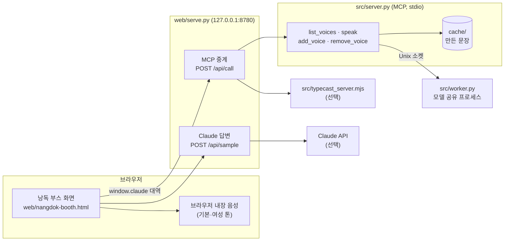

# 개발 스펙과 아키텍처

## 1. 개요

| 항목 | 내용 |
|---|---|
| 목적 | 한국어 대본을 복제 목소리로 읽고, 문장 뒤에 붙는 잡음·웃음·엉뚱한 말을 자동으로 잘라 깨끗한 음성을 만든다 |
| 실행 환경 | macOS, Apple Silicon(MPS), Python 3.11. 메모리 16GB 이상 권장 |
| 주요 라이브러리 | chatterbox-tts 0.1.7, torch/torchaudio 2.6.0, demucs 4.0.1, faster-whisper 1.2.1, numpy 1.26.4, anthropic 2.9 이상(선택) |
| 사용 모델 | Chatterbox Multilingual(음성 생성·복제), Demucs htdemucs(음원 분리), faster-whisper small int8(음성인식), Claude Opus 5.5(즉석 답변, 선택) |
| 사용 형태 | ① 명령줄(`src/clean_tts.py`) ② 낭독 부스 웹사이트(`web/serve.py`) ③ Claude 데스크톱 앱 아티팩트 |

## 2. 전체 구조



- **Claude 데스크톱 앱에서 열 때**: 화면의 `window.claude`(앱 제공)가 `host:localvoice`, `host:typecast` MCP 서버와 Claude 답변(`sample`)을 직접 연결합니다. `web/serve.py`는 쓰지 않습니다.
- **웹사이트로 열 때**: `web/serve.py`가 화면에 같은 모양의 `window.claude` 대역을 끼워 넣고, 요청을 MCP 서버와 Claude API로 전달합니다. 화면 코드는 두 경우 모두 같습니다.

## 3. 음성 처리 파이프라인


| 단계 | 설정 | 비고 |
|---|---|---|
| ① 생성 | exaggeration 0.5, cfg_weight 0.5, temperature 0.8, language `ko`, MPS | 참조 녹음 처리 결과를 (경로, 수정 시각, exaggeration)별로 캐시. 생성 후 새로 생긴 attention hook 제거 |
| ② 분리 | htdemucs, CPU, shifts 1, overlap 0.25 | 분리 결과가 원본 최대 음량의 10%보다 작으면 원본 사용 |
| ③ 인식 | small, int8, CPU, beam 1, temperature 0, word_timestamps | 한글을 자모(NFD)로 풀어 대본과 비교. 대본의 85% 이상(또는 끝 3자모 이내)까지 맞지 않으면 자르지 않음 |
| ④ 자르기 | 마지막 단어 끝 −0.1초부터 −30dB 아래 160ms 무음을 찾아 컷 → −35dB 위 마지막 소리 + 120ms까지 → 30ms 페이드아웃 | 20ms 프레임 RMS 기준 |

**성능** (Apple Silicon, 20문장 평균)

| 항목 | 값 |
|---|---|
| 모델 불러오기 | 10~16초 (처음 한 번) |
| 생성 | 10.8초 (5.8~24.2초) |
| 분리 + 자르기 | 3.1초 (1.95 + 1.14초) |
| 메모리 | 읽는 동안 9~11GB, 쉬면 0GB |

## 4. 구성 요소

### 4.1 `src/worker.py` — 모델 공유 프로세스

- 세 모델을 한 프로세스에만 올립니다. 여러 음성 서버가 Unix 소켓으로 요청을 보냅니다.
- 처음 요청한 서버가 파일 잠금(`flock`) 아래에서 띄우고, 나머지는 기다렸다가 연결합니다.
- 5분(`LOCALVOICE_IDLE_MIN`) 동안 요청이 없으면 종료하고, 메모리가 12GB(`LOCALVOICE_MAX_GB`)를 넘으면 현재 문장을 마친 뒤 종료합니다.
- **소켓 경로**: `/tmp/localvoice-<설치 폴더 해시 12자>.sock` (경로 길이 제한 회피, 설치마다 별도)
- **프로토콜**: 연결 하나에 JSON 한 줄

```json
요청: {"text": "읽을 문장", "ref": "/abs/path/ref.wav", "params": {"exaggeration": 0.5, "cfg_weight": 0.5, "temperature": 0.8}}
응답: {"wav": "<base64 WAV>"}  또는  {"error": "model|internal", "message": "..."}
```

### 4.2 `src/server.py` — 로컬 음성 MCP 서버

- 의존성이 거의 없는 stdio MCP 서버입니다(줄 단위 JSON-RPC). 모델을 직접 불러오지 않아 가볍습니다(약 10MB).
- 기본 목소리는 `voices.json`, 사람들이 등록한 목소리는 `custom_voices.json`에 있습니다. 녹음 파일이 없는 목소리는 목록에서 뺍니다.

| 도구 | 입력 | 출력 | 비고 |
|---|---|---|---|
| `list_voices` | 없음 | `{voices: [{id, name, user_added, models, ...}]}` | |
| `speak` | `text`(300자 이하), `voice_id`, `emotion`(normal·toneup·tonedown) | `{mime: "audio/wav", audio_base64, chars, cached}` | 캐시 키: `sha256([text, voice_id, ref, params, 후처리 버전])` 앞 32자 |
| `add_voice` | `name`(20자 이하), `audio_base64`(16비트 PCM WAV, 5~30초, 8MB 이하) | `{voice: {id, name, seconds}}` | id는 `u_` + 무작위 10자. 녹음마다 새 id라 예전 캐시가 섞이지 않음 |
| `remove_voice` | `voice_id`(등록한 목소리만) | `{removed, cached_removed}` | 녹음 파일, 목록 항목, 그 목소리의 캐시 폴더를 함께 삭제 |

- 오류는 `isError: true`와 `{error: 코드, message: 한국어 안내}`로 돌려줍니다.
- `custom_voices.json`은 잠금 파일(`.custom.lock`) 아래에서 읽고 쓰므로, 서버가 여러 개 떠 있어도 서로의 변경을 덮어쓰지 않습니다.

### 4.3 `src/typecast_server.mjs` — Typecast MCP 서버 (선택)

- `list_voices`, `speak` 두 도구를 같은 모양으로 제공해, 화면에서 로컬 복제와 바꿔 쓸 수 있습니다.
- API 키는 `TYPECAST_API_KEY` 환경 변수 또는 `.env`에서 읽고, 만든 음성은 `.typecast-cache/`에 저장해 크레딧을 아낍니다.

### 4.4 `web/serve.py` — 낭독 부스 웹서버

- 표준 라이브러리 `http.server`로 `127.0.0.1`에서만 열립니다(기본 포트 8780, `PORT`로 변경).

| 경로 | 동작 |
|---|---|
| `GET /` | 낭독 부스 화면에 `window.claude` 대역 스크립트를 끼워 넣어 보냄 |
| `POST /api/call` | `{server, tool, args}` → MCP 서버의 `tools/call` 결과 `{result}` 또는 `{error, message}` |
| `POST /api/sample` | `{prompt}` → Claude 답변 `{value: {item, answer}}` 또는 `{error, message}` |

- MCP 서버는 처음 요청 때 띄우고 계속 씁니다. 죽으면 한 번 다시 띄웁니다.
- **Claude 답변**: `claude-opus-5-5`, effort `low`, 응답 형식을 JSON 스키마 `{item: 정수, answer: 문자열}`로 고정, 안전 기준으로 거절되면 API가 다른 모델로 다시 실행(`fallbacks: "default"`). 키는 `ANTHROPIC_API_KEY`(환경 변수 또는 `.env`)에서 매번 읽습니다. 키가 없으면 화면이 준비된 기본 답변으로 대신합니다.
- **Ctrl+C**: HTTP 서버와 MCP 서버를 끄고 종료합니다. 모델 프로세스는 5분 뒤 스스로 종료합니다.

### 4.5 `web/nangdok-booth.html` — 낭독 부스 화면

외부 의존성 없는 HTML 한 파일입니다(글꼴만 Google Fonts).

| 모듈 | 내용 |
|---|---|
| 대본·재생 | 문장 단위로 나눠 읽고, 읽는 문장과 단어를 강조. 일시정지, 정지, 문장 눌러 거기서부터 읽기 |
| 음성 톤 | 기본·여성: 브라우저 `speechSynthesis`. 사투리: 전라도 말투로 바꾼 뒤 녹음 목소리(로컬 복제 또는 Typecast). 내 목소리: 대본 그대로 로컬 복제 |
| 재생 엔진 | 브라우저 음성은 문장마다 억양·속도를 조금씩 바꾸고 쉼을 둠. 복제 목소리는 남은 문장을 미리 순서대로 생성 |
| 진진가 | 질문 → 항목 추정(키워드 가중치 2/1) → 준비된 답 찾기(두 글자 단위 Dice 유사도, 항목을 알면 0.5, 모르면 0.62 이상) → 증거 요청이면 고정 문구 → 없으면 Claude 즉석 답변 → 실패하면 기본 답변 |
| 질문 먼저 읽기 | `이름: 질문`, `3번: 질문` 형식을 읽어 답 앞에 질문을 붙임. 30자 넘는 질문은 줄임 |
| 내 목소리 등록 | 마이크 녹음(`MediaRecorder`) 또는 파일 → 브라우저에서 24kHz 모노 16비트 WAV로 변환(작으면 음량 보정, 30초까지) → `add_voice` |
| 저장 | 톤·목소리·진진가 기록 등 화면 설정만 브라우저 `localStorage`에 저장 |

## 5. 파일과 저장 위치

```
src/
  worker.py, server.py, clean_tts.py, typecast_server.mjs
  voices.json            기본 목소리 목록
  custom_voices.json     등록한 목소리 목록      (저장소 제외)
  refs/                  참조 녹음, refs/custom/  (저장소 제외)
  cache/                 만든 문장, cache/<등록 목소리 id>/  (저장소 제외)
  worker.log             모델 프로세스 기록       (저장소 제외)
web/
  nangdok-booth.html, serve.py
eval/
  sentences.tsv, run_eval.py, results.csv, listening.csv, listen.html, listen_server.py
.env                     API 키                   (저장소 제외, .env.example 참고)
```

## 6. 보안과 개인정보

- 웹서버, 판정 서버 모두 `127.0.0.1`에만 열려 같은 컴퓨터에서만 접속됩니다.
- API 키는 `.env`에만 두고 저장소에 올리지 않습니다.
- 목소리 녹음과 만든 음성은 실행한 컴퓨터에만 저장됩니다. 다른 사람의 목소리는 본인 동의를 받고 등록해야 합니다.
- 공개 저장소의 진진가 데이터는 가상 인물 예시입니다. 상용 TTS 캐릭터 목소리 녹음은 포함하지 않았습니다.

## 7. 설계상 선택과 이유

| 선택 | 이유 |
|---|---|
| 모델을 공유 프로세스 하나에 | Claude 앱이 서버를 여러 개 띄워 각자 5GB씩 쓰던 문제 해결 |
| Demucs·Whisper를 CPU에서 | MPS에서 Chatterbox와 번갈아 돌리면 문장마다 GPU 메모리가 약 1GB씩 늘어남 |
| Whisper 온도 0 | 같은 음성은 항상 같은 위치에서 자르기 위해 |
| 자모 단위 비교 | 사투리를 표준어 쪽으로 알아듣는 경우에도 대본 끝을 찾기 위해 |
| 알아듣지 못하면 자르지 않음 | 단어가 잘리는 것보다 꼬리가 남는 편이 덜 나쁨 |
| 브라우저에서 WAV로 변환 | 서버에 ffmpeg 같은 디코더를 두지 않기 위해 |
| 등록 목소리마다 캐시 폴더 | 목소리를 지울 때 그 목소리로 만든 문장을 함께 지우기 위해 |
| 화면 코드 하나로 앱·웹 겸용 | 웹서버가 앱과 같은 모양의 `window.claude`를 제공 |
